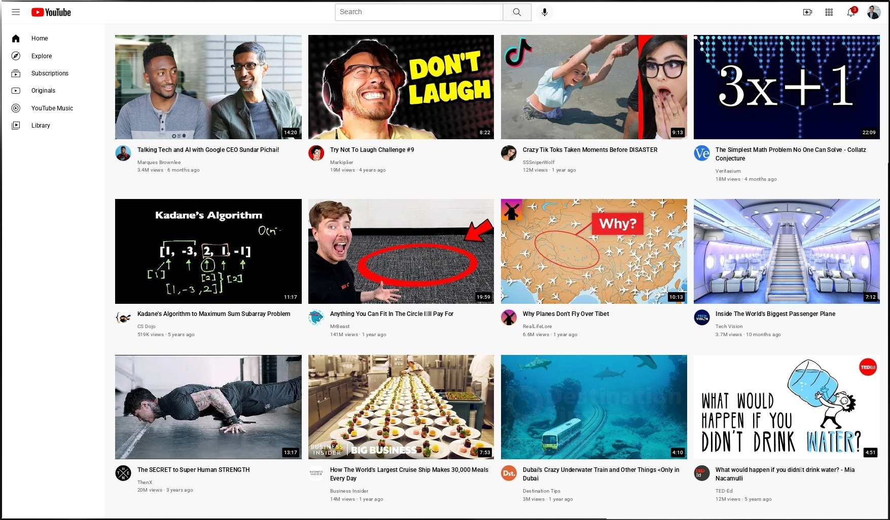

# YouTube.com Interface Clone

A responsive clone of the YouTube home page, built with **HTML and CSS only**.
I built it while learning front-end development.

**[Live demo](https://mahmdmkh.github.io/YouTube_-_Website/)**




## Features

- Fixed header with menu button, logo, search bar, voice search, upload,
  apps, notifications (with a counter), and a profile picture
- Tooltips on the header buttons, built with CSS only
- Fixed sidebar: icons with labels below 1200px, and a full sidebar with
  text beside the icons on wider screens
- Video grid with 12 video cards: thumbnail, duration badge, channel picture,
  title, channel name, and views
- Channel hover card (tooltip) on each profile picture
- Responsive video grid: 2 columns up to 750px, 3 columns up to 999px,
  and 4 columns from 1000px

## What I practiced

HTML structure and semantic tags (`header`, `nav`, `main`), CSS Grid,
Flexbox, positioning (fixed, absolute, relative), media queries,
hover effects and transitions, and Chrome DevTools.

## Tech

HTML5 · CSS3 (no JavaScript)

## Project structure

```
├── index.html
├── styles/      (general, header, sidebar, video-grid)
├── icons/
├── thumbnails/
└── screenshots/
```

## Known limitations and next steps

- This is a static UI: the menu button, search, and buttons don't work yet.
  I'm learning JavaScript to add this.
- Images need `alt` text and the page needs a `lang` attribute for better
  accessibility.
- Some values are fixed in `px`. I plan to use more flexible units.

## Credits

Built while following the course
[HTML & CSS Full Course - Beginner to Pro](https://www.youtube.com/watch?v=G3e-cpL7ofc)
by SuperSimpleDev. Thank you for the great free course!
